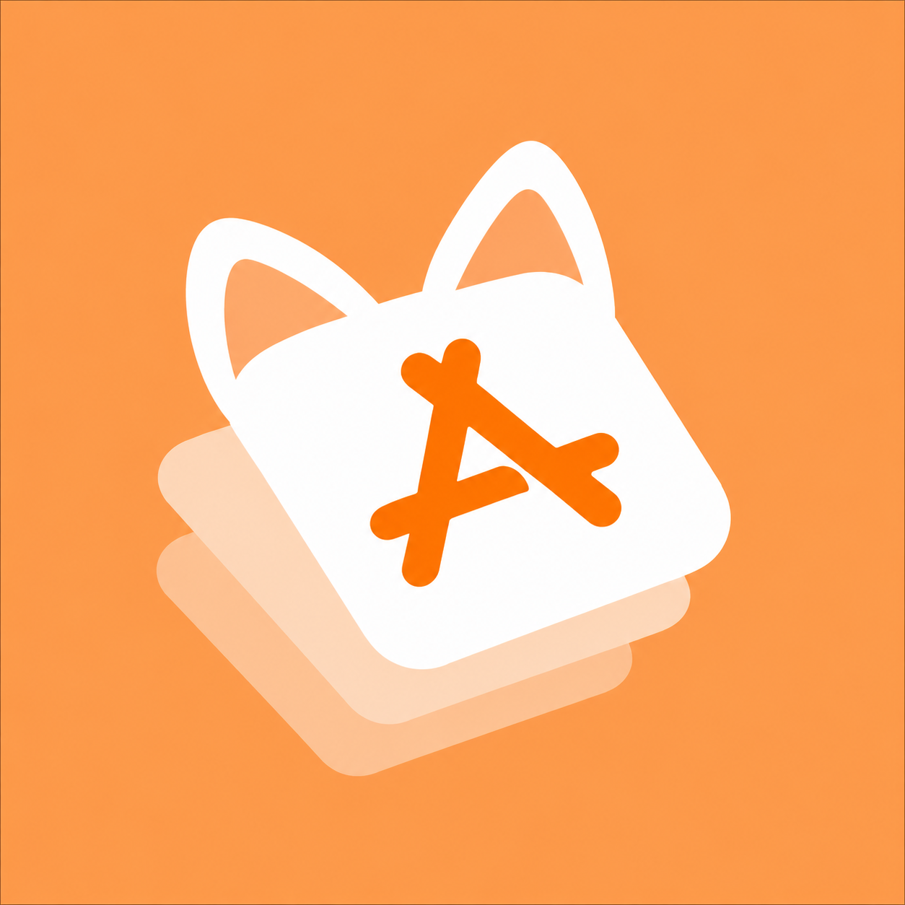

   

  

  <h1>SideNeko</h1>

  
<b>Sideloading, the neko way.</b>

  
by Thanking157

  

    A free, open-source, computer-free IPA sideloading tool for iOS / iPadOS :3
  

  

    All you need is your iPhone or iPad to import, sign, install, and manage IPA files! 
    No Mac, no Windows needed w
  

  [GitHub Repository](https://github.com/Thanking157/SideNeko) · [Installation Website](https://thanking157.github.io/SideNeko/) · [繁體中文](README.md)

---

## About SideNeko

SideNeko is a free, non-commercial, open-source iOS / iPadOS sideloading tool I made!

I hope to make it possible for everyone to sign and install IPA files directly on their iPhone or iPad using only their own Apple Account, without needing a computer :D

The goal is to make sideloading simpler and more convenient w

## ✨ Features

The following features are planned for SideNeko v1.0:

- 📱 **Computer-Free Installation** — The goal is to complete the initial installation directly on an iPhone / iPad without needing a Mac or Windows computer.
- 🔑 **Apple Account Signing** — Create development signatures using your own Apple Account, with two-factor authentication support.
- 📦 **IPA Import** — Import IPA files directly from the Files app.
- ✍️ **On-Device Signing** — Sign and install IPA files directly on your device.
- 🗂️ **App Management** — View and manage imported and installed apps.
- ⏰ **Signing Expiration Reminders** — Display signing expiration dates and reminders.
- 🐾 **Quick Installation Options** — Provide installation options for SideStore and LiveContainer.
- 🌎 **Multiple Languages** — Support Traditional Chinese and English.
- 🔒 **Privacy Protection** — No account secrets are processed through servers operated by SideNeko.

## 🚧 Current Development Status

SideNeko is still under development, and not all signing and installation features are complete yet awa

**Completed:**
- SwiftUI interface foundation for iPhone / iPad.
- Traditional Chinese and English language resources.
- Local IPA reading, basic ZIP validation, and SHA-256.
- Local app list storage, viewing, and deletion.
- Signing status data model.
- macOS core tests and iOS compilation tests.

**In Development:**
- Apple Account login and 2FA verification.
- Development certificates and IPA signing.
- iOS 27 on-device pairing and installation.
- Computer-free initial installation process.
- SideStore / LiveContainer quick installation.
- Real-device testing on iPhone / iPad.

Successful compilation doesn't mean all features are fully functional yet! Features will be gradually made available after real-device testing is completed :3

## 📲 Installation

SideNeko aims to let users complete the initial installation using only their iPhone or iPad!

The current plan is based on the publicly documented iOS 27 on-device installation method from SideInstaller / siboot, using Open Minis, LocalDevVPN, and a pairing channel.

Installation website:

https://thanking157.github.io/SideNeko/

**Note:** The computer-free installation process is still under development and testing.

A working release and installation instructions will be provided after verification is completed w

## ⚠️ Notes

This is my first time making this kind of iOS sideloading app w

The initial version may have some bugs or stability issues, so please bear with me @@;

If you encounter any problems or bugs, feel free to report them through GitHub Issues. I'll do my best to investigate and fix them :D

A few more things to keep in mind:

- Some features are still experimental, and actual results may vary depending on the device and iOS version.
- Signing expiration periods and limitations for free Apple Accounts are subject to Apple's policies.
- SideNeko does not guarantee compatibility with every device or that signed apps will never be revoked.
- SideNeko does not provide an IPA store, pirated resources, or shared enterprise certificates.

## 🔒 Privacy

SideNeko aims to keep important data on your own device whenever possible!

- Apple Account passwords will not be written to logs or regular files.
- Two-factor authentication codes will not be stored.
- Development certificates, private keys, and sensitive tokens must be protected using Keychain.
- IPA SHA-256 hashes are calculated locally, and IPA files are not uploaded to SideNeko servers.
- If the login process requires a remote Anisette service, you will be clearly informed before using it.

See [Security Information](docs/SECURITY.md) for more details.

## 📜 License

SideNeko is a free, non-commercial, open-source project!

Copyright (C) 2026 thanking157

SideNeko's original source code is licensed under the **GNU General Public License v3.0 (GPL-3.0)**.

For the full license, see [COPYING.md](COPYING.md).

Third-party components are used under their respective licenses. For more information, see [THIRD_PARTY_NOTICES.md](THIRD_PARTY_NOTICES.md).

## 💖 Credits

Thanks to the following open-source projects for research references and technical inspiration!

- [FrizzleM / SideInstaller](https://github.com/FrizzleM/SideInstaller)

SideNeko's computer-free installation design is based on SideInstaller's publicly available research and documentation.

For related licensing and technical research, see [Upstream Review](docs/UPSTREAM_REVIEW.md).

---

  Made with ♡ by Thanking157

  **Sideloading, the neko way.**

  Thank you all for your support! I hope SideNeko can make sideloading easier w

