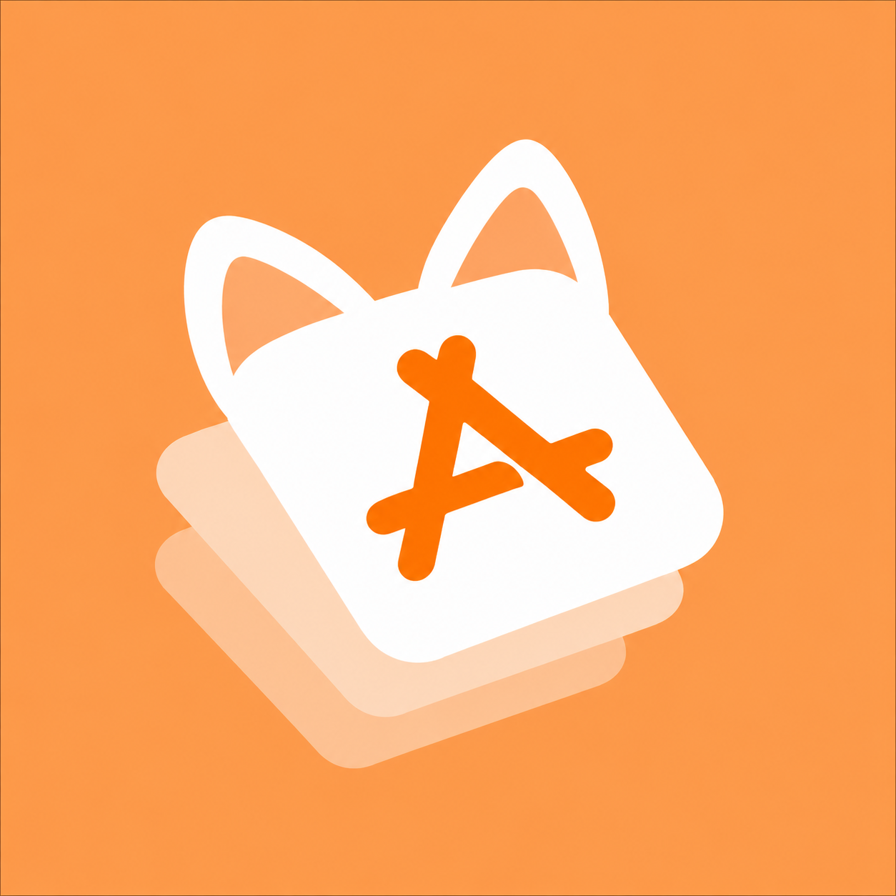

   

  

  <h1>SideNeko</h1>

  
<b>Sideloading, the neko way.</b>

  
by Thanking157

  

    一款免費、開源的 iOS / iPadOS 免電腦 IPA 側載工具 :3
  

  

    只需要自己的 iPhone 或 iPad，就能匯入、簽署、安裝及管理 IPA！ 
    不用 Mac、不用 Windows w
  

  [GitHub 專案](https://github.com/Thanking157/SideNeko) · [安裝網站](https://thanking157.github.io/SideNeko/) · [English](README.en.md)

---

## 關於 SideNeko
SideNeko 是我製作的一款免費、非商業、開源的 iOS / iPadOS 側載工具！
希望讓大家不用電腦，只使用自己的 Apple 帳號，就能在 iPhone 或 iPad 上簽署、安裝 IPA :D
目標是讓側載變得更簡單更方便w
## ✨ 功能
以下為 SideNeko v1.0 的規劃功能：
- 📱 **免電腦安裝** — 目標是在 iPhone / iPad 上完成首次安裝，不需要 Mac 或 Windows。
- 🔑 **Apple 帳號簽署** — 使用自己的 Apple 帳號建立開發簽署，支援雙重驗證。
- 📦 **IPA 匯入** — 直接從「檔案」App 匯入 IPA。
- ✍️ **本機簽署** — 在裝置端完成 IPA 簽署與安裝。
- 🗂️ **App 管理** — 查看及管理已匯入與安裝的 App。
- ⏰ **簽署到期提醒** — 顯示簽署有效期限及到期提醒。
- 🐾 **快速安裝入口** — 提供 SideStore、LiveContainer 的安裝選項。
- 🌎 **多語言** — 支援繁體中文與英文。
- 🔒 **隱私保護** — 不透過 SideNeko 自營伺服器處理帳號秘密資料。

## 📲 安裝
SideNeko 的目標是讓使用者只需要 iPhone 或 iPad，就可以完成首次安裝！
安裝網站：
https://thanking157.github.io/SideNeko/

## ⚠️ 注意
這是我第一次製作這類 iOS 側載 App w
初版可能會有一些 Bug 或不穩定的情況，還請大家見諒 @@;
如果遇到問題或 Bug，歡迎透過 GitHub Issues 回報，我會盡量確認並修復 :D
## 🔒 隱私
SideNeko 會盡可能把重要資料保留在自己的裝置上!
- Apple 帳號密碼不會寫入日誌或一般檔案。
- 雙重驗證碼不會被保存。
- 開發憑證、私鑰及敏感 token 必須受到 Keychain 保護。
- IPA 會在本機計算 SHA-256，不會上傳至 SideNeko 伺服器。
- 如果登入流程需要遠端 Anisette 服務，會在使用前清楚告知。
詳見 [安全說明](docs/SECURITY.md)。

## 📜 授權
SideNeko 是一個免費、非商業、開源專案！
Copyright (C) 2026 thanking157
SideNeko 原創程式碼採用 **GNU General Public License v3.0 (GPL-3.0)** 授權。
完整授權請參閱 [COPYING.md](COPYING.md)。
第三方元件依各自授權條款使用，相關資訊請參閱 [THIRD_PARTY_NOTICES.md](THIRD_PARTY_NOTICES.md)。

## 💖 致謝
感謝以下開源專案提供研究參考與技術啟發！
- [FrizzleM / SideInstaller](https://github.com/FrizzleM/SideInstaller)
SideNeko 的免電腦安裝設計參考 SideInstaller 的公開研究與說明
相關授權及技術研究請參閱 [上游審查](docs/UPSTREAM_REVIEW.md)。

---

  Made with ♡ by Thanking157

  **Sideloading, the neko way. **

  感謝大家的支持！希望 SideNeko 能讓側載變得更簡單w

